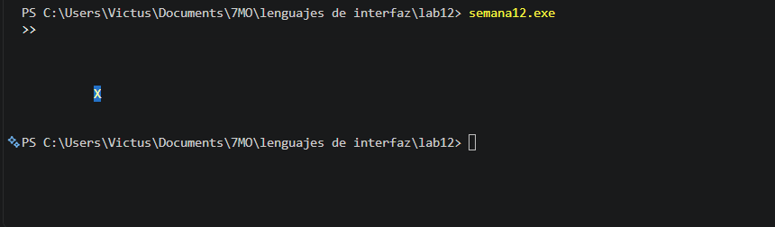
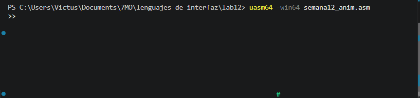

# Laboratorio 12 – Ensamblador x64: pintar y animar un carácter en la consola

**Alumno:** Magaña Nuñez Julio Alejandro
**Módulo 4 – Semana 12**
**Video de demostración:** https://youtu.be/xOQjLkTO0P4

---

## Descripción

Programa en ensamblador x64 para Windows que usa la API de consola de `kernel32.dll` para dibujar y animar un carácter en color. El laboratorio tiene dos partes:

| Parte | Archivo | Qué hace |
|-------|---------|----------|
| 1 | `semana12.asm` | Limpia la consola y pinta un carácter en color en una posición (X, Y) específica. |
| 2 | `semana12_anim.asm` | Mueve un carácter de izquierda a derecha por una fila de la consola (animación). |

## Requisitos

- Windows de 64 bits
- [UASM](http://www.terraspace.co.uk/uasm.html) (`uasm64`)
- [GoLink](http://www.godevtool.com/) (`GoLink.exe`)

## Compilación y ejecución

**Parte 1**

```cmd
uasm64 -win64 semana12.asm
GoLink.exe semana12.obj kernel32.dll /fo semana12.exe /console /entry main
semana12.exe
```

**Parte 2**

```cmd
uasm64 -win64 semana12_anim.asm
GoLink.exe semana12_anim.obj kernel32.dll /fo semana12_anim.exe /console /entry main
semana12_anim.exe
```

> **Consejo:** abre una consola nueva y ejecuta `cls` antes de correr el programa. Las posiciones se miden desde la esquina superior izquierda del *búfer* de la consola; si la ventana está desplazada hacia abajo, el carácter puede quedar fuera de la parte visible.

---

## Parte 1 – Pintar un carácter

Pasos que sigue el programa:

1. `GetStdHandle(-11)` obtiene el handle de la salida estándar.
2. `FillConsoleOutputCharacterA` y `FillConsoleOutputAttribute` limpian la pantalla (espacios y color por defecto).
3. `SetConsoleCursorPosition` mueve el cursor a (X, Y).
4. `SetConsoleTextAttribute` fija el color.
5. `WriteConsoleA` escribe el carácter.
6. Se restaura el color normal y se coloca el cursor debajo del dibujo para que el prompt no lo pise.

**Resultado esperado:** una `X` amarilla sobre fondo azul en la posición (10, 5).



### ¿Cómo se construye el valor COORD?

La estructura `COORD` de Windows son dos enteros de 16 bits (`X` e `Y`). Al pasarla por valor en un registro, se empaquetan en 32 bits:

| Bits 31–16 | Bits 15–0 |
|------------|-----------|
| Y (fila)   | X (columna) |

```
valor = (Y << 16) | X
Ejemplo (X = 10, Y = 5):  (5 << 16) | 10 = 0x0005000A
```

En el código se calcula al ensamblar: `mov rdx, (FILA shl 16) or COLUMNA`. En la Parte 2, donde X cambia en cada iteración, se calcula en tiempo de ejecución con `shl rax, 16` y `or rdx, rax`.

### Atributo de color

El atributo es un byte: el **nibble alto** es el color de fondo y el **bajo** el del texto.

| Valor | Color | Valor | Color |
|-------|-------|-------|-------|
| 0 | Negro | 8 | Gris oscuro |
| 1 | Azul | 9 | Azul brillante |
| 2 | Verde | A | Verde brillante |
| 3 | Cian | B | Cian brillante |
| 4 | Rojo | C | Rojo brillante |
| 5 | Magenta | D | Magenta brillante |
| 6 | Amarillo oscuro | E | Amarillo brillante |
| 7 | Gris claro | F | Blanco |

Por ejemplo, `1Eh` = fondo azul (`1`) + texto amarillo brillante (`E`).

---

## Parte 2 – Animación básica

Lógica del bucle principal:

```
X = 0
repetir:
    si X > 0:  borrar la posición (X-1, Y) escribiendo un espacio
    mover el cursor a (X, Y)
    escribir el carácter
    Sleep(RETARDO_MS)
    X = X + 1
mientras X < COLUMNA_FIN
```

**Resultado esperado:** una `X` verde recorre la fila 10 de izquierda a derecha sin dejar rastro.



---

## Funciones de la API de Windows utilizadas

| Función | Para qué se usa |
|---------|-----------------|
| `GetStdHandle` | Obtener el handle de la consola de salida. |
| `FillConsoleOutputCharacterA` | Limpiar la pantalla llenándola de espacios. |
| `FillConsoleOutputAttribute` | Restablecer los colores de toda la pantalla. |
| `SetConsoleCursorPosition` | Colocar el cursor en una posición (X, Y). |
| `SetConsoleTextAttribute` | Cambiar el color del texto y del fondo. |
| `WriteConsoleA` | Escribir un carácter en la posición del cursor. |
| `Sleep` | Pausar el programa para controlar la velocidad (Parte 2). |
| `ExitProcess` | Terminar el programa. |

> **Convención x64 de Windows:** los primeros 4 parámetros van en `RCX`, `RDX`, `R8`, `R9`; el 5.º se coloca en la pila en `[rsp + 20h]`. Se reservan 28h bytes (shadow space + 5.º parámetro) para que la pila quede alineada a 16 bytes antes de cada `call`.

---

## Modificaciones probadas

Los valores se cambian en la sección `CONFIGURACION` al inicio de cada archivo.

| Archivo | Constante | Original | Modificado |
|---------|-----------|----------|------------|
| `semana12.asm` | `COLUMNA`, `FILA` | 10, 5 | 30, 12 |
| `semana12.asm` | `ATRIBUTO` | `1Eh` (amarillo sobre azul) | `4Fh` (blanco sobre rojo) |
| `semana12_anim.asm` | `RETARDO_MS` | 50 | 20 (más rápido) |
| `semana12_anim.asm` | `caracter` | `'X'` | `'#'` |

---

## Estructura del repositorio

```
.
├── semana12.asm
├── semana12_anim.asm
├── README.md
├── parte1.png
└── parte2.png
    
```
